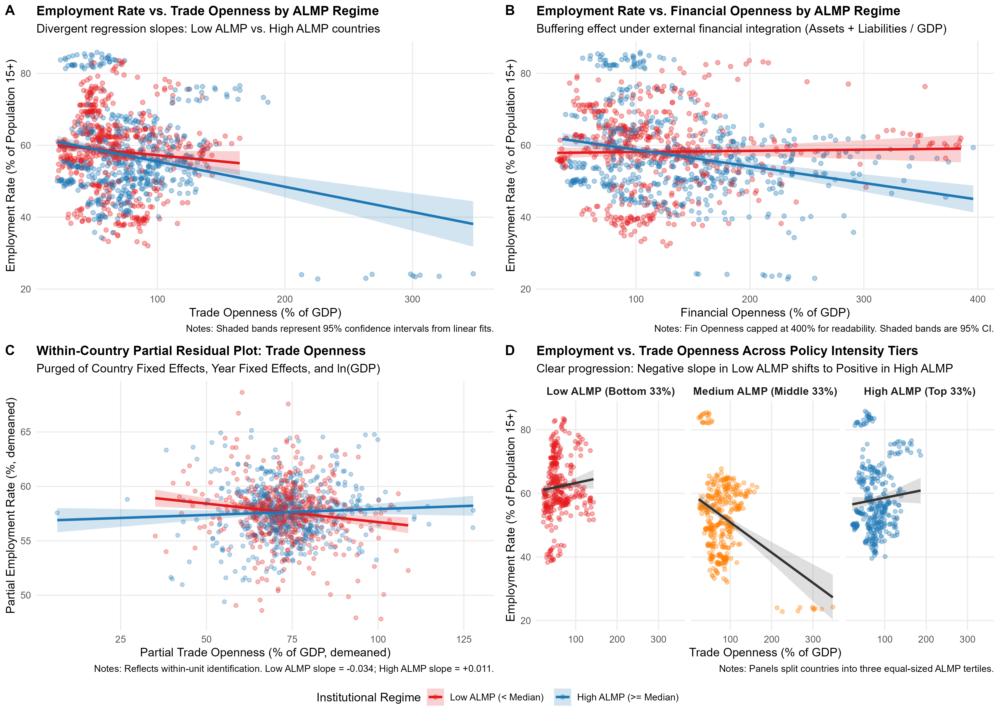
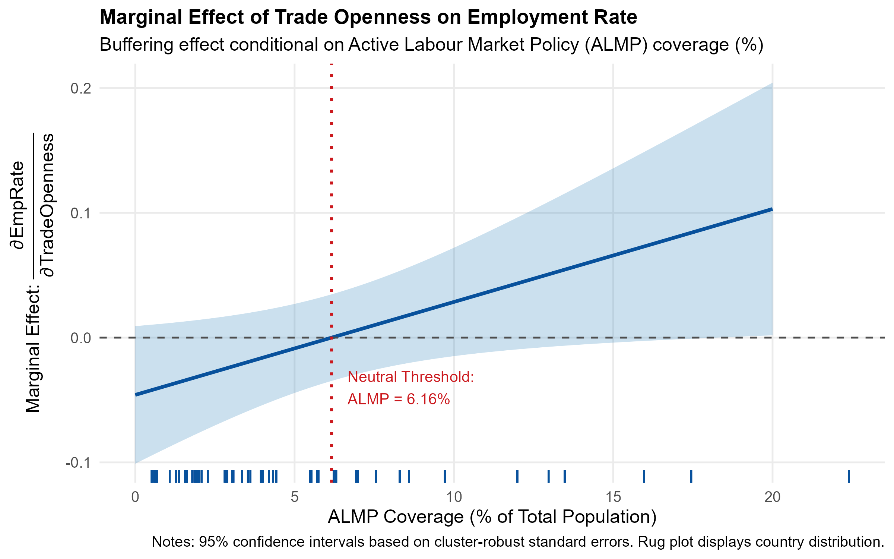
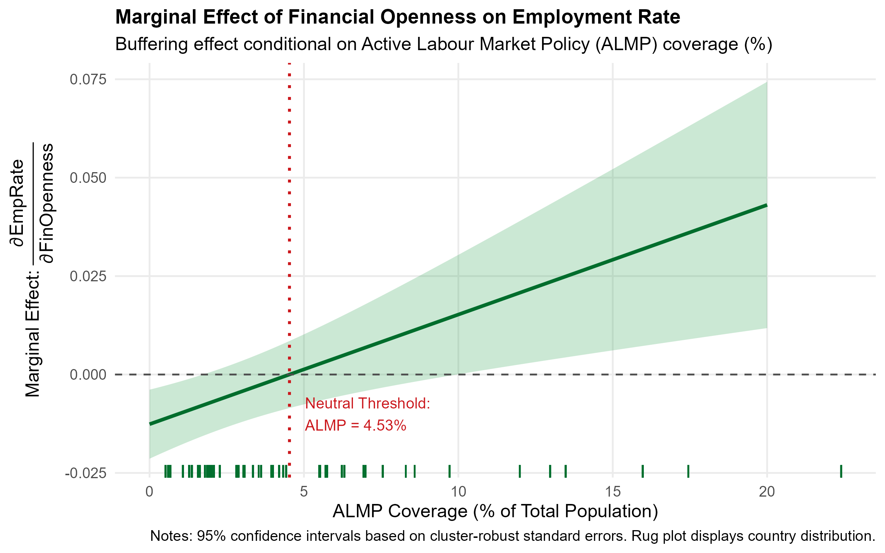
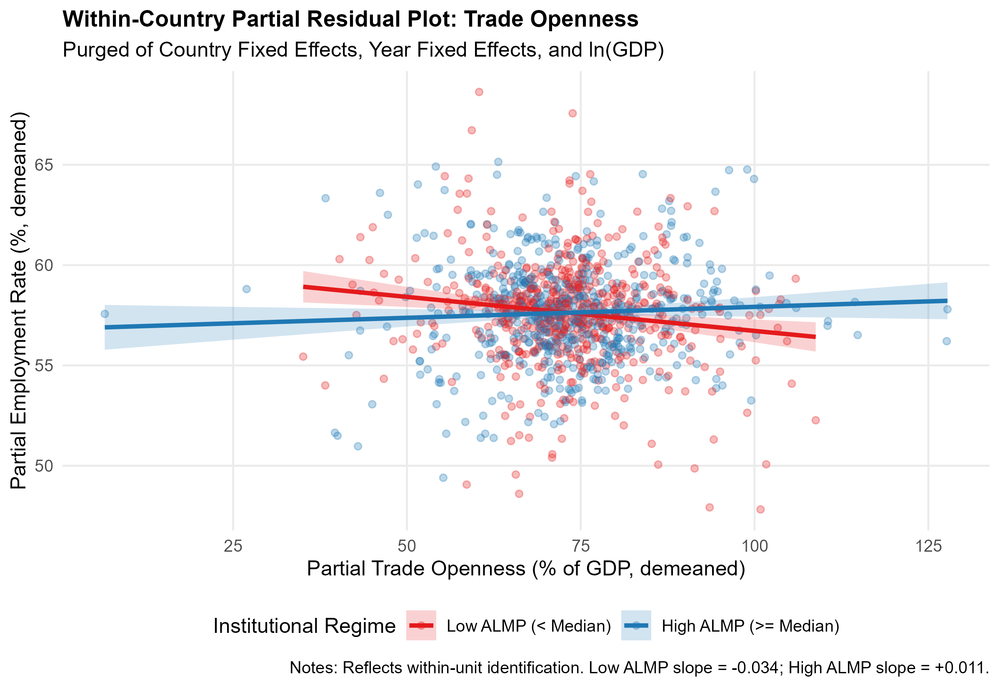
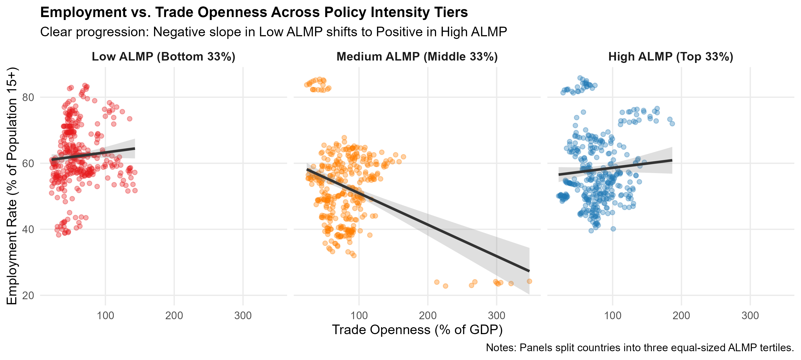

Do Active Labour Market Policies Mitigate Openness Shocks?


> **Cambridge Econometric Research Project**  
> **Author:** Nurmash  
> **Script:** [`code_new.R`](code_new.R)
---
1. EXECUTIVE SUMMARY

This research tests whether Active Labour Market Policies (ALMP) act as a structural buffer against adverse labor market dislocations caused by Trade Openness and Financial Openness.
Resolving data sparseness in institutional surveys via macroeconomic panel interaction methods (Blanchard & Wolfers, 2000; Rodrik, 1998), this project analyzes 1,117 country-year observations across 50 countries (2000–2022) using Two-Way Fixed Effects (TWFE) and country-clustered robust standard errors.

This project involved support from Antigravity - an AI agent which helped me debug the code and address key econometric data problems identified - such as sparse data collection and robustness checking. The workflow started with me finding data, cleaning it up, writing a preliminary code, and then asking Antigravity to clear up any issues with data and solve modelling problems - such as pivoting from time-variant ALMP as a DV, to mean ALMP as a structural buffer against variations in trade and financial openness.

Key Empirical Findings

Employment Rate (`emp_rate`):

Trade Openness: In low-ALMP countries, trade expansion exerts downward pressure on employment (β̂<sub>trade</sub> = -0.0459). However, the interaction term Trade × ALMP is positive and statistically significant (β̂<sub>int</sub> = +0.0074, p = 0.040). Once ALMP coverage exceeds 6.16% of the population, the marginal effect of trade on employment turns net positive.

Financial Openness: Financial integration negatively impacts employment in minimal-support environments (β̂<sub>fin</sub> = -0.0126, p = 0.0075). The interaction FinOpen × ALMP is strongly positive (β̂<sub>int</sub> = +0.0028, p = 0.0038). ALMP neutralizes financial shock dislocations at coverage above 4.53%.

Unemployment Rate (`unemp_rate`):

Symmetrically, trade openness increases unemployment in low-ALMP regimes (β̂<sub>trade</sub> = +0.0313), but higher ALMP significantly suppresses this spike (β̂<sub>int</sub> = -0.0091, p = 0.0108).
Macroeconomic Robustness:

In 3-year period-averaged panels (filtering business cycle volatility and survey timing noise), buffering interactions remain robust and statistically significant (Trade × ALMP p = 0.059; FinOpen × ALMP p = 0.015).
---
2. REPOSITORY STRUCTURE & DATA
```
├── code_new.R                       # Production-ready econometric estimation & visualization script
├── emp.csv                          # Employment rate data (% of population 15+)
├── unemp.csv                        # Unemployment rate data
├── trade.csv                        # Trade Openness (% of GDP)
├── fin.xlsx                         # Financial Openness (Capital flows / Assets + Liabilities / GDP)
├── lab.xlsx                         # ASPIRE Labor Market & Social Protection Indicators
├── lab.dta                          # Stata formatted ASPIRE dataset
│
├── master_econometric_visualizations.png  # Master 4-panel summary dashboard
├── marginal_effect_trade.png              # Delta method marginal effect curve for Trade
├── marginal_effect_financial.png          # Delta method marginal effect curve for Financial Openness
├── partial_residual_trade.png             # Frisch-Waugh-Lovell within-country partial residuals
├── facet_regression_tertiles.png          # 3-tier tertile progression across ALMP intensity
├── scatter_regression_trade.png           # Bivariate scatterplot by ALMP regime (Trade)
└── scatter_regression_financial.png       # Bivariate scatterplot by ALMP regime (Financial Openness)
```
---
3. ECONOMETRIC METHODOLOGY
   
Primary Structural Specification (TWFE)

Following the shocks-and-institutions literature (Blanchard & Wolfers, 2000; Rodrik, 1998), ALMP coverage represents a country's long-run structural policy capacity:
$$\text{emp_rate}{it} = \beta_1 \text{Trade}{it} + \beta_2 (\text{Trade}{it} \times \overline{\text{ALMP}}i) + \beta_3 \text{FinOpen}{it} + \beta_4 (\text{FinOpen}{it} \times \overline{\text{ALMP}}i) + \gamma \ln(\text{GDP}{it}) + \alpha_i + \delta_t + \varepsilon_{it}$$

Country Fixed Effects (α<sub>i</sub>): Purges all time-invariant unobserved country heterogeneity (geography, culture, baseline institutional quality, and the standalone baseline ALMP level).
Year Fixed Effects (δ<sub>t</sub>): Absorbs global macroeconomic shocks (e.g., 2008 Global Financial Crisis, COVID-19 pandemic).

Cluster-Robust SEs: Standard errors are clustered at the country level (`iso3c`).

Identification: Identified strictly from within-country time-series variation in external shocks interacting with cross-sectional structural institutional capacity.
---
4. REGRESSION RESULTS
Primary Models: Employment Rate

Two-Way Fixed Effects (Country + Year FE), Clustered SEs by Country (N = 1,117 / 50 Countries)
Regressors	(1) Trade Openness	(2) Financial Openness	(3) Combined Model

Trade Openness (`trade_pct_gdp`)	-0.0555* (0.0317)	—	-0.0459 (0.0281)

Trade × ALMP (`trade_pct_gdp:almp_mean`)	+0.0087* (0.0045)	—	+0.0074* (0.0035, p = 0.040)

Financial Openness (`fin_open`)	—	-0.0164*** (0.0059)	-0.0126*** (0.0045, p = 0.0075)

FinOpen × ALMP (`fin_open:almp_mean`)	—	+0.0031** (0.0013)	+0.0028*** (0.0009, p = 0.0038)

ln(GDP)	-0.1275 (1.168)	-0.0163 (1.245)	-0.3359 (1.189)

Fixed Effects	Country + Year	Country + Year	Country + Year
Within R²	0.0424	0.0483	0.0762

*p < 0.10, **p < 0.05, ***p < 0.01. Standard errors in parentheses.
---
5. VISUALIZATIONS & DIAGNOSTICS
1. Master Econometric Visualizations
Comprehensive 4-panel dashboard summarizing regime regressions, within-unit partial residuals, and policy intensity tertiles.

---
2. Marginal Effects & Neutral Thresholds (Delta Method)
The marginal effect of openness is conditional on structural ALMP capacity:
$$\frac{\partial , \text{emp_rate}}{\partial , \text{Openness}} = \hat{\beta}{\text{Openness}} + \hat{\beta}{\text{Interaction}} \times \overline{\text{ALMP}}_i$$
Trade Neutrality Threshold: ALMP ≥ 6.16%

Financial Neutrality Threshold: ALMP ≥ 4.53%

---
3. Within-Country Identification & Slopes
Frisch-Waugh-Lovell Partial Residual Plot
Purged of Country Fixed Effects, Year Fixed Effects, and ln(GDP). Demonstrates true within-unit identification:

Tertile Progression Across Policy Intensity
Transition from negative slope in Low-ALMP countries to flat in Medium-ALMP and positive in High-ALMP countries:

Direct Regime Comparisons
Trade Openness Scatter Plot: `scatter_regression_trade.png`
Financial Openness Scatter Plot: `scatter_regression_financial.png`
---
6. REPRODUCIBILITY & DIAGNOSTICS
Primary Data Diagnostics Resolved in `code_new.R`
Column Selection Offset: Corrected sub-header index alignment in `lab.xlsx` to isolate total population active labor market coverage rather than cash transfer sub-indexes.

Interpolation Sparseness: Handled irregular ASPIRE survey frequency to prevent panel truncation.

Variable Standardisation: Unified uninterpolated variables in Model specifications.

One problem might be that the data mostly covers developing countries, at the same time having high ALMP requires prior and general availability of complex institutional architecture. As a broad suite of policy, countries with high ALMP also tend to have more generous social safety nets and higher buffers against structural and cyclical shifts in the economy - must account for that for more rigour. 

Running the Code
To execute the entire pipeline, estimate all econometric specifications, and generate all high-resolution figures:
```bash
# Execute from shell / command prompt
Rscript code_new.R
```
Required R Packages: `tidyverse`, `fixest`, `readxl`, `haven`, `marginaleffects`, `ggplot2`, `patchwork`.
---
7. REFERENCES
Blanchard, O., & Wolfers, J. (2000). The role of shocks and institutions in the rise of European unemployment: the aggregate evidence. The Economic Journal, 110(462), C1-C33.
Rodrik, D. (1998). Why do more open economies have bigger governments? Journal of Political Economy, 106(5), 997-1032.
